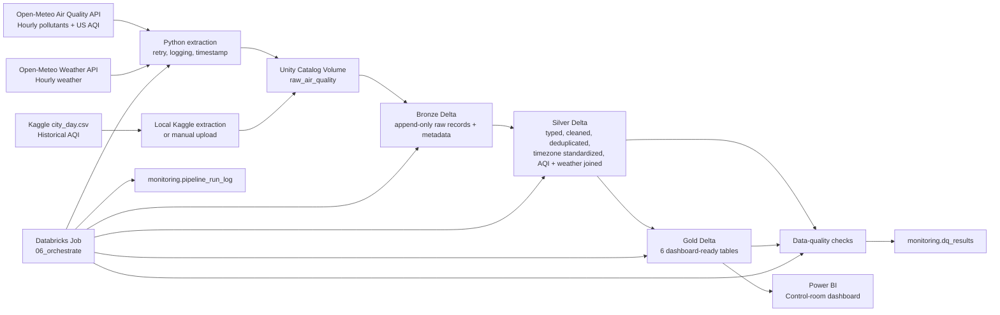

# Architecture

## Layer responsibilities

| Layer | Technology | Responsibility | Output |
|---|---|---|---|
| Extraction | Python + requests/Kaggle API | Pull two Open-Meteo feeds and historical CSV; retry failures | Timestamped JSON/CSV |
| Raw | Unity Catalog Volume | Immutable source landing zone; no DBFS root | `/Volumes/<catalog>/raw/raw_air_quality` |
| Bronze | PySpark + Delta | Preserve raw source records and ingestion metadata; append only | Three Bronze tables |
| Silver | PySpark + Delta MERGE | Cast types, null/outlier treatment, city/time standardization, deduplication, AQI-weather join | Hourly environment + daily AQI |
| Gold | PySpark + Delta | Compact business aggregates for reporting | Six Gold tables |
| BI | Power BI | Interactive analysis, drill-through, tooltips, and KPI storytelling | Five report pages + City Detail |
| Monitoring | PySpark + Delta | Data quality and orchestration audit history | `dq_results`, `pipeline_run_log` |

## Design decisions

- Unity Catalog Volumes provide governed raw storage; no DBFS root is used.
- Bronze is append-only to preserve source lineage. Silver uses a business-key Delta `MERGE` for rerun safety.
- API timestamps are interpreted as `Asia/Kolkata`, then stored with both local and UTC time.
- Open-Meteo supplies current hourly coverage; Kaggle supplies longer daily history.
- The Gold layer intentionally contains only dashboard-facing tables to keep Power BI simple and fast.
